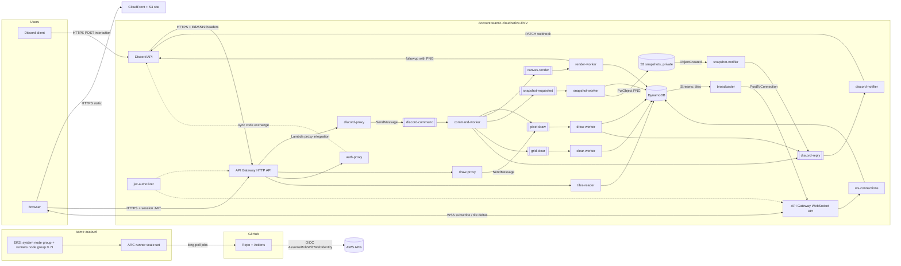

# Architecture — MVP (AWS)

Source of truth: `Cloud Native_ DevOps, IaC & Serverless.pdf` (Subject + C00–C08).
This document must stay in sync with what is deployed (the defense checks it against `prd`).
The defense diagram (draw.io, official AWS icons) is generated from the diagrams below.

## 1. Provider choice: AWS

| Need from the subject | AWS answer | Notes |
|---|---|---|
| Real-time canvas, no polling | API Gateway WebSocket API + DynamoDB Streams + `connections` table + `broadcaster` Lambda | More moving parts than a managed realtime DB; it is our code, so we can explain every hop |
| Frontend auth + realtime auth | Session JWT minted by `auth-proxy` (sub = Discord id), checked by one Lambda authorizer on HTTP **and** WebSocket APIs | One token, one validation path |
| Broker + DLQ + retries | SQS queue per worker, redrive to `<queue>-dlq` after 5 receives | Lambda event source mapping with `ReportBatchItemFailures` |
| Snapshot ready event | S3 `s3:ObjectCreated:*` notification → Lambda | Built in |
| Keyless CI | GitHub OIDC identity provider + IAM role per env | Standard `aws-actions/configure-aws-credentials` |
| Runners cluster | EKS, managed node groups, Cluster Autoscaler | Control plane is billed hourly (no free tier): destroy dev foundation when idle |
| Monitoring | CloudWatch (metrics, Logs Insights, dashboards, alarms), Container Insights, X-Ray | No monitoring stack to host |

Environments: AWS Organizations with a management (payer) account and two member accounts `<team>-cloudnative-dev` and `<team>-cloudnative-prd`, created by the `infra/org` stack from one `team` variable; same code, different `*.tfvars`. Only the management account is created by hand (sign-up, card, root MFA, free credits). Team members sign in through IAM Identity Center (permission set on both accounts). Region: one region for everything (e.g. `eu-west-3`).

## 2. Big picture



Every SQS queue has a dead-letter queue `<queue>-dlq` (`maxReceiveCount` 5, visibility timeout = 6 × function timeout).

## 3. Foundation

| Component | Choice | Notes |
|---|---|---|
| Network | 1 VPC/env, public + private subnets on 2 AZs (EKS needs 2), **one** NAT gateway, gateway endpoints for S3 and DynamoDB | Nodes in private subnets, egress through NAT only; one NAT is the cost trade-off (not AZ-redundant) |
| Cluster | EKS, API auth mode with access entries (deployer role + team SSO role), EKS Pod Identity, add-ons `vpc-cni`, `coredns`, `kube-proxy`, `eks-pod-identity-agent`, `amazon-cloudwatch-observability` | Hosts runners only, never the app |
| Node groups | `system` (1× t3.medium, fixed) and `runners` (t3.large, autoscaling **0–3**, taint `runners=true:NoSchedule`, label `pool=runners`) | Max size is the cost safeguard; ASG tags `k8s.io/cluster-autoscaler/node-template/{label,taint}/…` let the autoscaler scale up from 0 |
| Autoscaler | Cluster Autoscaler via `helm_release`, Pod Identity role scoped to the cluster's ASGs | Scale-down of empty runner nodes after ~10 min |
| Runners | Actions Runner Controller: charts `gha-runner-scale-set-controller` + `gha-runner-scale-set` via `helm_release` | `minRunners: 0`, `maxRunners: 6`, ephemeral pods, toleration for the runner taint, CPU requests sized so 2 runners ≈ 1 node → pod demand forces node scale-up |
| Runner auth to GitHub | GitHub App (app id, installation id, private key) in Secrets Manager → k8s Secret created by Terraform | Never in the repo |
| CI auth to AWS | IAM OIDC provider `token.actions.githubusercontent.com`; one deployer role per account whose trust policy requires `aud = sts.amazonaws.com` and `sub = repo:<org>/<repo>:environment:<env>` | No access keys anywhere |
| Budgets | AWS Budgets per account, alerts at 50/90/100 % | In `infra/access` |

### Terraform stacks

| Stack | Path | Destroyable by workflow | Contents |
|---|---|---|---|
| org | `infra/org` | **No** (`prevent_destroy`) | AWS Organization (IAM Identity Center enabled), one member account per env (`<team>-cloudnative-<env>`, email `<local>+<env>@<domain>`); IAM Identity Center users (from `team_emails`, gitignored), `team` group with the `AdministratorAccess` permission set on all accounts; outputs account ids, `OrganizationAccountAccessRole` ARNs and the SSO start URL |
| access | `infra/access` | **No** | One workspace per env (`terraform workspace select <env>`, enforced). tfstate bucket `<team>-cloudnative-<env>-tfstate`, GitHub OIDC provider, `github-deployer` role (AdministratorAccess for now), instructor IAM user (`ReadOnlyAccess` + `AWSBillingReadOnlyAccess`; credentials created by hand and shared through a one-time secure channel, so they never reach state), monthly budget 50/90/100 % to `budget_emails` (gitignored). GitHub collaborators (incl. `Kloox`) still to add |
| foundation | `infra/foundation` | Yes | VPC, NAT, EKS, node groups, Cluster Autoscaler, ARC Helm releases, runner secret |
| serverless | `infra/serverless` | Yes | Secrets (entries only, values set out of band), SQS, Lambdas, HTTP + WebSocket APIs, DynamoDB, buckets, CloudFront site, CloudWatch dashboards + alarms |

Account targeting: every stack except `org` runs in a member account. Locally the provider assumes `arn:aws:iam::<account_id>:role/OrganizationAccountAccessRole` from the management account; in CI it uses the deployer role created by `access`.

State: `org` starts with local state (no bucket exists yet), then migrates with `terraform init -migrate-state` to a bucket in the management account. Other stacks: S3 bucket per account (versioned, SSE, public access blocked), locking with `use_lockfile = true` (Terraform ≥ 1.10, no DynamoDB lock table), `backend` config in `infra/<stack>/backends/<env>.hcl`.
`org` is applied once from the management account, then `access` once per member account from a laptop through `aws sso login` (chicken-and-egg: it creates the identity CI uses), then also planned in CI.

## 4. Serverless application

### 4.1 Functions (Lambda, `nodejs22.x` / TypeScript)

One dedicated execution role per function. No function has a function URL or a public resource policy: HTTP/WebSocket handlers allow `lambda:InvokeFunction` only to `apigateway.amazonaws.com` with the API's `SourceArn`; workers are invoked by SQS event source mappings (permission on the worker's own role: `sqs:ReceiveMessage`/`DeleteMessage` on its queue only); `snapshot-notifier` allows only `s3.amazonaws.com` with the bucket's `SourceArn`.

| Function | Trigger | Single job | IAM beyond logs/traces |
|---|---|---|---|
| `jwt-authorizer` | Lambda authorizer (HTTP API + WebSocket `$connect`), result cached 5 min | Verify session JWT signature + expiry → return `sub` (Discord id) in context | read secret `session-jwt-key` |
| `discord-proxy` | `POST /discord/interactions` | Verify Ed25519 over raw body (401 if bad) → PING→PONG → send to `discord-command` → reply `{type:5}` | read secret `discord-public-key`; send to `discord-command` |
| `draw-proxy` | `POST /pixels` (authorizer) | Validate body (≤ 256 pixels, bounds, color) → send to `pixel-draw` → `202` | send to `pixel-draw` |
| `auth-proxy` | `POST /auth/discord` | Exchange OAuth `code` (scope `identify`) → read Discord user id → **drop** access token → return session JWT (1 h) | read secrets `discord-client-secret`, `session-jwt-key` |
| `tiles-reader` | `GET /tiles/{tile}` (authorizer) | Query one tile's pixels for the current `epoch` (initial load) | `dynamodb:Query` on `tiles`, `GetItem` on `meta` |
| `ws-connections` | WebSocket `$connect`, `$disconnect`, `subscribe`, `unsubscribe` | Keep the tile subscriptions of each connection (≤ 64 tiles) | read/write `connections` |
| `broadcaster` | DynamoDB Stream on `tiles` (+ `meta` for clear/epoch) | Group changed pixels by tile → find subscribed connections → `PostToConnection`; delete connection on `410 Gone` | `Query` on `connections`; `execute-api:ManageConnections` on the WebSocket API |
| `command-worker` | `discord-command` | Check admin (role id or allow-list from `meta`), apply pause/resume/ratelimit, route draw/get/snapshot/clear to their queues | read/write `meta`; send to 5 queues |
| `draw-worker` | `pixel-draw` | Idempotency + pause + rate limit + pixel writes (§4.4); reply to Discord if origin is Discord | read/write `tiles`, `meta`, `ratelimits`, `processed`; send to `discord-reply` |
| `render-worker` | `canvas-render` | Render downscaled PNG (e.g. 2000×2000) of the grid, upload as followup attachment | read `tiles`; read `discord-bot-token` |
| `snapshot-worker` | `snapshot-requested` | Render full PNG → `s3://…-snapshots/snapshot-<ISO8601>.png` with object metadata (interaction token, app id) | read `tiles`; `s3:PutObject` on snapshot bucket |
| `snapshot-notifier` | S3 `ObjectCreated` | Presigned GET URL (1 h) → send to `discord-reply` | `s3:GetObject` + `HeadObject` on snapshot bucket; send to `discord-reply` |
| `clear-worker` | `grid-clear` | Bump `meta.epoch` (clients clear instantly), then delete old pixel items in `BatchWriteItem` pages | read/write `tiles`, `meta` |
| `discord-notifier` | `discord-reply` | PATCH `webhooks/{app}/{token}/messages/@original` | none (interaction token is the credential) |

`auth-proxy`, `tiles-reader` and `ws-connections` are the only synchronous handlers: they establish identity, read state or manage subscriptions, never change the grid. Justify this at the defense.

The presigned URL is bounded by the signing credentials: if the Lambda session expires before 1 h, the link dies early. Acceptable for the MVP; mention at the defense.

### 4.2 API Gateway

HTTP API (OpenAPI 3.0 body in Terraform):

| Route | Security | Backend |
|---|---|---|
| `POST /discord/interactions` | none at gateway (Discord cannot send a JWT); Ed25519 in proxy is the first check | `discord-proxy` |
| `POST /auth/discord` | none | `auth-proxy` |
| `POST /pixels` | `jwt-authorizer` | `draw-proxy` |
| `GET /tiles/{tile}` | `jwt-authorizer` | `tiles-reader` |

WebSocket API (route selection `$request.body.action`): `$connect` (`jwt-authorizer`, token in query string `?token=`), `$disconnect`, `subscribe`, `unsubscribe` → `ws-connections`.

The authorizer returns the user id in `requestContext.authorizer.lambda.sub`; `draw-proxy` takes it from there, never from the body. CORS on the HTTP API allows only the CloudFront origin.

### 4.3 Event envelope (all queues)

```json
{
  "id": "uuid",                 // idempotency key
  "type": "pixel.draw",
  "correlation_id": "uuid",     // created by the proxy, copied to every child event
  "origin": "discord|web",
  "user_id": "discord user id",
  "ts": "ISO8601",
  "discord": { "app_id": "...", "token": "..." },   // only when origin = discord
  "data": { "pixels": [{ "x": 10, "y": 20, "color": "#ff0000" }] }
}
```

`correlation_id` and W3C `traceparent` are also set as SQS message attributes so traces continue across hops (X-Ray also propagates `AWSTraceHeader` through SQS → Lambda natively).

### 4.4 Data model (DynamoDB, on-demand)

Grid: 10000×10000, tiles of 64×64 → 157×157 = 24 649 possible tiles; only painted pixels exist. **One item per pixel**: DynamoDB bills writes by whole item size (1 KB units) and caps items at 400 KB, so one item per tile would cost hundreds of WCU per pixel.

| Table | Keys | Attributes | Purpose |
|---|---|---|---|
| `tiles` | PK `tile` = `"<tx>_<ty>"`, SK `px` = `"<lx>_<ly>"` | `c` (#rrggbb), `a` (Discord id), `n` (username), `t` (ISO8601), `epoch` | Current state; one `Query` loads a tile (≤ 4096 items ≈ 400 KB, one page). Stream `NEW_AND_OLD_IMAGES` |
| `meta` | PK `id` = `global` | `paused`, `epoch`, `default_limit` (20), `admin_ids`, `admin_role_id` | Session state, admin allow-list. Stream on for `epoch`/`paused` changes |
| `ratelimits` | PK `user_id` | `window_start`, `count`, `limit_override?` | Fixed 60 s window per user |
| `processed` | PK `event_id` | `status` (`accepted`\|`done`), `accepted` (pixels), `expire_at` (TTL 24 h) | Idempotency for redelivered messages |
| `connections` | PK `tile`, SK `conn_id`; GSI `by_conn` (PK `conn_id`) | `expire_at` (TTL 2 h = WebSocket max lifetime) | Who listens to which tile |

Write path (`draw-worker`) per message:
1. `GetItem processed/{id}`: `done` → delete message, stop; `accepted` → skip to step 4 with the stored pixels (redelivery after a partial write).
2. Read `meta`; if `paused` → reject (reply to Discord).
3. `TransactWriteItems`: conditional update of `ratelimits/{user}` (keep only the first `limit - count` pixels) + `Put processed/{id}` with `attribute_not_exists` and `status = accepted`. Concurrent duplicate → condition fails → stop.
4. `BatchWriteItem` the accepted pixels (25 per call, retry `UnprocessedItems`); upserts are idempotent (last writer wins).
5. `UpdateItem processed/{id}` → `status = done`.

Brush strokes are capped per message (256 px). A tile partition takes 1000 WCU/s, so hot tiles are not the bottleneck at our scale; SQS absorbs bursts and Lambda concurrency (reserved concurrency per worker) bounds the write rate.

Clear: `clear-worker` bumps `meta.epoch` first; `broadcaster` pushes a `clear` message to every connection and `tiles-reader` ignores items with an older `epoch`, so the canvas empties instantly; old items are then deleted in the background.

### 4.5 Real-time path and frontend

- Hosting: private S3 bucket + CloudFront (Origin Access Control, managed HTTPS, default `*.cloudfront.net` cert) — Vite + TypeScript, HTML `<canvas>` rendering. Deployed by CI with `aws s3 sync` + invalidation.
- Login: "Login with Discord" → Discord authorize (`identify`) → redirect back with `code` → `POST /auth/discord` → session JWT kept in memory (not `localStorage`).
- Viewport: compute visible tiles from pan/zoom; for each new tile `GET /tiles/{tile}` then `{"action":"subscribe","tiles":[...]}` on the WebSocket (cap 64 tiles, `unsubscribe` tiles that leave the viewport). Server pushes `{tile, pixels:[...]}` deltas and `{type:"clear", epoch}`. No polling anywhere; reconnect with backoff re-subscribes and reloads visible tiles.
- Each tile kept as an `ImageData` / offscreen canvas; redraw only changed tiles.
- Inspect: click → read the cached pixel → show author + timestamp.
- Draw / brush: brush size 1–15; stroke pixels batched (≤ 256 per request) → `POST /pixels`.
- The browser never talks to DynamoDB: reads go through `tiles-reader` and the WebSocket, writes only through workers.

### 4.6 Secrets (Secrets Manager)

`discord-public-key`, `discord-bot-token`, `discord-client-id`, `discord-client-secret`, `session-jwt-key`, `github-app-private-key` (+ ids). Terraform creates the secret entries; values are added with `aws secretsmanager put-secret-value` (never in Git or tfvars). Functions read them at cold start with the SDK and cache them; each role gets `secretsmanager:GetSecretValue` on its own secret ARNs only.

## 5. CI/CD

| Workflow | Trigger | Jobs |
|---|---|---|
| `ci.yml` | `pull_request` to `main` | `terraform fmt -check -recursive`, `validate` (each stack), `plan` matrix {foundation, serverless} × {dev, prd}, app lint + unit tests + build |
| `release.yml` | push tag `v*.*.*` | build function zips + frontend → apply `foundation` + `serverless` to **dev** (environment `dev`) → apply to **prd** (environment `prd`, required reviewers) → sync frontend to the env's S3 bucket + CloudFront invalidation |
| `destroy.yml` | `workflow_dispatch` (input `env`, type-to-confirm) | destroy `serverless` then `foundation` for that env |
| `load-runners.yml` | `workflow_dispatch` (input `jobs`) | matrix of N jobs that `sleep` to force runner node scale-up (defense demo) |

Every job authenticates with `aws-actions/configure-aws-credentials` (`role-to-assume: ${{ vars.AWS_ROLE_ARN_<ENV> }}`, `permissions: id-token: write`).

Runner switch without code changes: `runs-on: ${{ vars.RUNNER_LABEL || 'ubuntu-latest' }}` (repo variable set to the scale set name once ARC is up), plus a `runner` input on dispatch workflows. Foundation apply always stays on `ubuntu-latest` so it can never depend on runners it is replacing.

Function source is zipped by Terraform (`archive_file` → `aws_lambda_function.filename` + `source_code_hash`), so a change to code changes the hash and redeploys the function: one IaC path for infra and code.

## 6. Observability

| Requirement | Implementation |
|---|---|
| Cluster metrics | Container Insights (`amazon-cloudwatch-observability` add-on): nodes, pods, CPU/RAM; CloudWatch agent Prometheus scrape of ARC listener metrics (`gha_*` jobs running/pending, runners busy) |
| App metrics | Lambda (`Invocations`, `Errors`, `Duration`, `Throttles`, `ConcurrentExecutions`), API Gateway (`5xx`, `Latency`), SQS (`ApproximateNumberOfMessagesVisible`, `ApproximateAgeOfOldestMessage`, DLQ visible messages), DynamoDB throttles |
| Dashboards | `aws_cloudwatch_dashboard` JSON in Terraform: "Foundation" (nodes, pods, CPU/RAM, runner jobs) and "Application" |
| Logs | Structured JSON to stdout → CloudWatch Logs (retention 14 d): `level, message, function, correlation_id, user_id, event_type, trace_id`; queried with Logs Insights `filter correlation_id = "…"` |
| Traces | X-Ray active tracing on every Lambda + API Gateway; OpenTelemetry (ADOT layer) with `traceparent` carried in SQS attributes |
| Alerts | CloudWatch alarms → SNS topic → email. Resource: runner node group CPU > 85 % for 10 min. App: API 5xx ratio > 5 %; `ApproximateAgeOfOldestMessage` > 60 s; any DLQ message. Discord channel (SNS → Lambda webhook) is a later add |
| Scale proof | Locust script (`loadtest/`) hitting `/pixels` with test JWTs, plus the brush; `load-runners.yml` for node autoscaling |
